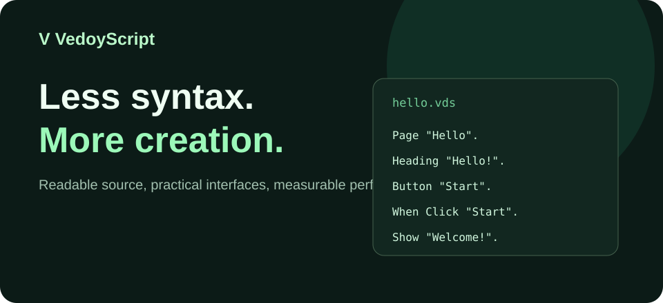

<div align="center">



# VedoyScript

**Less syntax. More creation.**

[Documentation](./docs/intro.md) · [Getting started](./docs/getting-started.md) · [Examples](./examples/) · [Performance](./docs/performance.md)

</div>

VedoyScript is an **experimental readable programming language** with capitalized commands, period-terminated statements and four-space indentation. The current beta handles simple web pages, layouts, compile-time structured data and basic interactions.

## Try the docs website

Requires Node.js 22+:

```bash
npm install
npm run start
```

`npm run check` validates the content and runs a production build. The website uses Docusaurus and includes a marketing homepage, examples, performance discussion and 16 documentation pages.

## Language example

```text
Page "Hello".
    Heading "Hello, world!".
    Button "Say hi" as "go".
    When Click "go".
        Show "Hello from VedoyScript!".
```

## Status and ownership

- **VedoyScript**: language grammar, semantics, specification and docs.
- **VedoyPolyglot**: planned central compiler/build tooling and multi-language adapters. [Experimental MVP PR](https://github.com/leandervedoy/vedoy-dev-studio/pull/6).
- **Vedoy Forge**: development experience, editor and project tooling. [Forge beta PR](https://github.com/leandervedoy/vedoy-dev-studio/pull/3).
- The current compiler is still experimental in [Vedoy Dev Studio PR #2](https://github.com/leandervedoy/vedoy-dev-studio/pull/2), and is **not yet extracted** into a standalone language package.

**Performance and brevity:** 80% less source code and fastest runtime are targets, **not verified claims**. See [our methodology](./docs/performance.md).

## Hosting

Import this repository into Vercel. Build with `npm run build`, output directory `build`. Set the actual website URL in `docusaurus.config.js` (currently a placeholder) before production launch.

## License

See [LICENSE](./LICENSE). No compiler source was copied here; review licensing and dependency licenses before public release.
